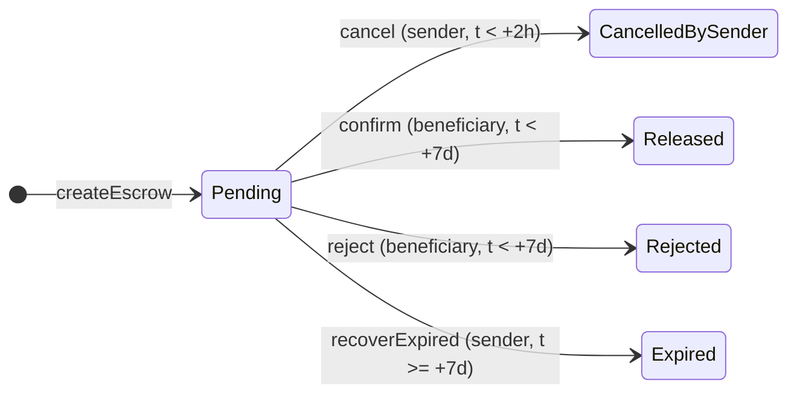

# Diseño y decisiones

Diseño del contrato, del indexador y de la API, decisiones sobre las ambigüedades del enunciado y limitaciones conocidas. Cómo correr el proyecto y sus pruebas está en el [README](../../README.md) y la ruta de desarrollo en el [ROADMAP](ROADMAP.md). Las revisiones de cierre están en [`docs/security.md`](../security.md) y [`docs/correctness.md`](../correctness.md).

## Índice

- [Arquitectura](#arquitectura)
- [Ejecución y tests](#ejecución-y-tests)
- [Contrato](#contrato)
- [API e indexador](#api-e-indexador)
- [Decisiones sobre ambigüedades del enunciado](#decisiones-sobre-ambigüedades-del-enunciado)
- [Limitaciones conocidas](#limitaciones-conocidas)
- [Puntos opcionales elegidos](#puntos-opcionales-elegidos)
- [Qué mejoraría con más tiempo](#qué-mejoraría-con-más-tiempo)

## Arquitectura

```
┌────────────┐   txs (wallet)   ┌───────────────┐
│  Usuarios  │ ───────────────▶ │  Escrow.sol   │  (Anvil local / testnet)
└────────────┘                  └───────┬───────┘
                                        │ eventos (eth_getLogs)
                                        ▼
                               ┌─────────────────┐   upserts + checkpoint
                               │   Indexador     │ ─────────────────────▶ ┌──────────┐
                               └─────────────────┘   (una tx de DB)       │ Postgres │
                               ┌─────────────────┐ ◀───────────────────── └──────────┘
   curl / HTTP  ─────────────▶ │   API (HTTP)    │   lecturas
                               └─────────────────┘ ── timestamp del último bloque ──▶ RPC
```

| Pieza | Tecnología |
| --- | --- |
| Contrato | Solidity 0.8.37 (`evm_version = "cancun"`), Foundry, OpenZeppelin v5 (`SafeERC20`, `ReentrancyGuardTransient`) |
| API / indexador | Node.js + TypeScript, viem |
| Dependencias Solidity | Soldeer (integrado en `forge`): sin submódulos de git |
| Base de datos | Postgres |
| Nodo local | Anvil |
| Ejecución | **Solo Docker Compose:** no hace falta Node, Foundry, solc ni Python en el host |

Versiones fijadas:

| Componente | Versión |
| --- | --- |
| Foundry (imagen `ghcr.io/foundry-rs/foundry`) | `v1.8.3` |
| solc | `0.8.37`, `evm_version = "cancun"` |
| forge-std / OpenZeppelin Contracts | `1.16.2` / `5.7.0` (`soldeer.lock`) |
| Node (imagen) | `node:24.21.0-bookworm-slim` |
| Dependencias npm | exactas, en `package-lock.json` |
| Postgres (imagen) | `postgres:17.11-alpine3.24` |

Estructura prevista del repo:

```
contracts/          proyecto Foundry (src/, test/, script/) + Dockerfile
api/                API + indexador + demo (TypeScript) + Dockerfile
docker/             Dockerfile de Slither, init de Postgres
docs/               hallazgos de Slither, gas report, outputs de IA
docker-compose.yml
docker-compose.sepolia.yml   el contrato deployado en Sepolia: indexador, deploy y demo
docker-compose.monad.yml     lo mismo en Monad testnet
.env.example        overrides opcionales (puertos, confirmaciones); todo tiene default
.env.sepolia.example         claves del deploy y la demo en Sepolia, en .env.sepolia (ignorado)
.env.monad.example           claves del deploy y la demo en Monad testnet, en .env.monad (ignorado)
```

### Servicios de compose

| Servicio | Rol | Arranca con `up` |
| --- | --- | --- |
| `anvil` | Nodo local | sí |
| `deployer` | One-shot: deploya y escribe `deployments/31337.json` en un volumen compartido, salvo que el archivo ya describa la cadena | sí |
| `postgres` | Base de datos (y base `escrow_test` para los tests) | sí |
| `api` | Indexador + API HTTP | sí |
| `demo` | Flujo completo de punta a punta | no (`run`) |
| `forge` | Foundry contra `./contracts` montado: build, test, fmt, snapshot, coverage | no (`run`) |
| `npm` | Node contra `./api` montado: test, lint, typecheck, generación de ABI | no (`run`) |
| `slither` | Análisis estático | no (`run`) |

Los servicios de herramientas usan `profiles`, así que `docker compose up` no los arranca. `docker compose run --rm <servicio> …` activa su perfil automáticamente.

### Stack

- **Orden de arranque.** Primero `anvil` sano, después `deployer`, y por último `api`, que además espera a `postgres` sano. Cada servicio de larga vida tiene healthcheck:
  - `anvil`: `cast block-number`
  - `postgres`: `pg_isready` por TCP
  - `api`: `GET /health` con el `fetch` de Node, porque la imagen `runtime` no tiene curl. Como `/health` responde `503` mientras el indexador va atrasado, `api` recién figura sana cuando alcanzó a la cadena.
- **Deploy idempotente.** `docker compose up` vuelve a correr los servicios one-shot en cada arranque, aunque el stack ya esté corriendo. También lo hace `docker compose run` de un servicio que depende de ellos, como la demo.
  - Un segundo deploy en la misma cadena dejaría a la API indexando el primer contrato.
  - Por eso [`script/deploy.sh`](../../contracts/script/deploy.sh) deploya solo si `deployments/31337.json` no describe la cadena. Hace los mismos chequeos que el guard de cadena: el hash del `startBlock` y que haya código en la dirección del contrato.
- **Cadena efímera, base persistente.** Anvil no guarda estado, así que cada arranque de su contenedor es una cadena nueva. Los volúmenes `pgdata` y `deployments`, en cambio, sobreviven a `docker compose down`.
  - Al volver a levantar, el deployer deploya de nuevo, y la API vacía la base y reindexa, porque compose fija `RESET_ON_CHAIN_MISMATCH=true`.
  - Si Anvil se reinicia solo con la API corriendo, la API sale con código 1 por el guard de cadena. Un `docker compose up` lo recompone.
- **Puertos.** La API y Anvil se publican solo en `127.0.0.1`. Anvil tiene las cuentas desbloqueadas: abierto a la red, cualquiera podría mandar transacciones con `eth_sendTransaction`. Postgres no se publica, porque compose no puede activar un puerto con una variable, y se consulta con `docker compose exec postgres psql -U escrow escrow`.
- **Logs.** Anvil registra cada llamada RPC: con el stack quieto son unas 2,4 líneas por segundo, por el polling del indexador y los healthchecks. Con `attach: false`, `docker compose up` no las muestra, y `docker compose logs anvil` sí. Requiere Compose 2.20.
- **Configuración.** Cada variable tiene default, así que no hace falta un `.env`. [`.env.example`](../../.env.example) lista los overrides: los puertos y las variables del indexador y la API. Si no se definen, compose las pasa vacías y la API toma su propio default, así no se duplican.
- **Imágenes.** Las dos imágenes del stack copian solo lo que usan, así que cambiar los tests no reconstruye ninguna:
  - `contracts:build` copia `src/`, `script/` y el token de prueba.
  - En `api`, una etapa `deps` instala las dependencias y de ella salen `dev` y `build`. `build` copia solo `tsconfig*.json` y `src/`.

## Ejecución y tests

- **Código montado.** `forge` y `npm` montan el código del host, así que corren sobre la copia de trabajo actual sin reconstruir imágenes.
- **Tests de la API** (`api/test/`). Los unitarios cubren el proyector, `toView` y la búsqueda del retiro máximo, contra modelos de token con un oráculo independiente. Los de integración corren contra Anvil y Postgres reales, sin tocar el stack principal:
  - **Anvil propio.** Cada archivo levanta un Anvil efímero en un puerto libre, con el binario incluido en la imagen, y deploya con el bytecode generado.
  - **Schema propio.** Cada archivo crea un schema en la base `escrow_test` del servicio `postgres` y lo usa por `search_path`, así los archivos corren en paralelo.
  - **Oráculo: la cadena.** Los eventos guardados tienen que ser exactamente los logs del contrato. Cada fila de `escrows` tiene que coincidir con `getEscrow`, más las transacciones y los timestamps de sus logs, y las de `withdrawals`, con los logs de `EscrowWithdrawn`.
  - **Un token con comisión aparte.** Con el token de prueba, lo que un retiro saca del contrato y lo que recibe el titular coinciden, así que un test los confundiría sin notarlo. Un test deploya `FeeOnTopERC20` para que difieran.
  - **Kill real.** Un proceso indexador (`MODE=indexer`) se mata con SIGKILL a mitad de camino y se reanuda. Un trigger, además, hace fallar un batch después de que guardó sus eventos, para comprobar que la transacción no deja nada.
  - **HTTP.** Los endpoints se prueban con `fastify.inject`, sin abrir puertos. Los límites de tiempo se prueban al segundo, con `evm_setNextBlockTimestamp`.
  - **Mutaciones.** Se comprobó que los tests detectan 19 bugs introducidos a mano, y otros 10 en el código de los retiros. El detalle está en las fases 8 y 13 del [ROADMAP](ROADMAP.md).
- **Fuzz e invariantes.** El handler de invariantes mantiene un modelo de referencia de cada escrow, predice el resultado de cada llamada (éxito o el error exacto) y lo compara con el contrato. Por eso corre con `fail_on_revert = true`. El perfil por defecto hace 256 runs; el perfil `ci` hace 10.000 runs de fuzz y 512 × 100 de invariantes.
- **Gas.** Cada `forge test` reescribe `contracts/snapshots/EscrowGasTest.json` con el gas de cada operación; los cambios aparecen en el diff. `forge coverage` no lo reescribe, porque compila sin optimizador. Ver [`docs/gas.md`](../gas.md).
- **Dependencias.** La primera vez, o cuando cambia el lockfile, el entrypoint instala las dependencias desde el contenedor en `api/node_modules/` y `contracts/dependencies/`. Las dos carpetas están ignoradas por git.
- **Permisos.** Los servicios `forge` y `npm` arrancan como root y el entrypoint baja, con `setpriv`, al dueño del código montado. Así los archivos generados quedan del usuario del host con Docker clásico, rootless o Docker Desktop, sin configurar nada.
- **Demo** ([`api/scripts/demo.ts`](../../api/scripts/demo.ts)). Manda las transacciones con viem desde las cuentas 0 y 1 de Anvil, que el deploy ya fondeó, así que no necesita mintear. Fuera de Anvil, en [Sepolia](#sepolia) o [Monad testnet](#monad-testnet), usa las cuentas de `SENDER_PRIVATE_KEY` y `BENEFICIARY_PRIVATE_KEY` y mintea los tokens que le faltan.
  - El vencimiento se simula con `evm_increaseTime` (el `ttl` del archivo de deploy) y `evm_mine`: la API informa `ExpiredRecoverable` mientras el contrato sigue diciendo `Pending`.
  - Cada escrow se crea justo antes de su acción, y el de vencimiento va al final, porque avanzar el tiempo del nodo afecta a todos los escrows a la vez. Después de cada resolución, el titular retira todo, con `minReceived` igual al monto.
  - **Smoke test.** Después de cada transacción espera a que la API la refleje: que exista el escrow, que tenga `resolvedTx` o un retiro, o que su `now` haya alcanzado el bloque nuevo. Recién ahí compara la vista completa, así un valor equivocado falla enseguida, con cada campo distinto, y no al vencer la espera de 30 s. También verifica los saldos: que resolver no mueva tokens y que el retiro le llegue entero al titular. Cualquier diferencia termina con código 1.
  - **Confirmaciones.** Con `CONFIRMATIONS` > 0, mina esa cantidad de bloques después de cada transacción. Si no, con el automine de Anvil el indexador no la vería nunca.
  - **Fuera de Anvil** (el chain id del archivo de deploy no es `31337`): no mina ni mueve el tiempo. La red produce los bloques, y para el vencimiento espera un bloque con timestamp a partir de `expiresAt`. La espera máxima por paso suma 24 s por confirmación, y antes de empezar verifica que las dos cuentas tengan ETH para el gas.
  - **Código actual sin montar `./api`.** El servicio `demo` usa la imagen `api:dev` con `pull_policy: build`: compose la reconstruye en cada `run`, en 1,6 s si no cambió nada, y no instala nada en el host.
- **CI** ([`.github/workflows/`](../../.github/workflows/)). Hay tres workflows: `contracts`, `api` y `e2e`. Corren los comandos del README en un runner `ubuntu-24.04` y no instalan nada, porque el runner ya trae Docker y Compose.
  - **Cuándo.** En cada push a `main` y en cada pull request, sin filtros de paths: un cambio en `docker-compose.yml` o en un Dockerfile siempre se prueba. En un pull request, un push nuevo cancela la corrida anterior; en `main`, cada commit conserva su resultado.
  - **Sin cache de capas.** Cada corrida construye las imágenes de cero, como en una máquina limpia. Las tres imágenes de herramientas tardan 30 s sin cache en la máquina de desarrollo.
  - **Seguridad.** `permissions: contents: read`, `actions/checkout` fijada por SHA (es la única acción) y `persist-credentials: false`, para no dejar el token en `.git/config` mientras corren dependencias de terceros.
  - **Diagnóstico.** Cada job imprime la versión de Compose. Si `e2e` falla, imprime los logs de todo el stack, Anvil incluido.

## Contrato

### Interfaz

```solidity
function createEscrow(address token, address beneficiary, uint256 amount) external returns (uint256 id);
function cancel(uint256 id) external;          // sender, t <  createdAt + CANCEL_WINDOW
function confirm(uint256 id) external;         // beneficiary, t <  createdAt + TTL
function reject(uint256 id) external;          // beneficiary, t <  createdAt + TTL
function recoverExpired(uint256 id) external;  // sender, t >= createdAt + TTL
function withdraw(uint256 id, uint256 transferAmount, uint256 minReceived) external;  // titular, ya resuelto
function getEscrow(uint256 id) external view returns (EscrowView memory);
function escrowCount() external view returns (uint256);   // ids válidos: 1..escrowCount()
function CANCEL_WINDOW() external view returns (uint64);
function TTL() external view returns (uint64);
```

La interfaz completa, con NatSpec, está en [`contracts/src/IEscrow.sol`](../../contracts/src/IEscrow.sol).

- **Token como `address`:** se pasa como `address`, igual que en la firma del evento que pide el enunciado.
- **Timestamps en `uint64`:** alcanzan de sobra y permiten empaquetarlos.

`CANCEL_WINDOW = 2 hours` y `TTL = 7 days` son `immutable` y se fijan en el constructor, que revierte con `InvalidWindows` salvo que `0 < cancelWindow < ttl`.

- **Por qué `immutable` y no constantes:** permite deployar en una testnet con ventanas cortas (por ejemplo, minutos) para mostrar el vencimiento en vivo, donde no se puede avanzar el tiempo del nodo. Los tests y el demo en Anvil usan los valores reales y avanzan el tiempo (`vm.warp`, `evm_increaseTime`).
- **Sin tope superior para `ttl`.** Se evaluó y se descartó:
  - Un `ttl` absurdo, del orden de 2⁶⁴ − `block.timestamp` (unos 584 mil millones de años), haría desbordar `createdAt + TTL` y todo `createEscrow` revertiría con `Panic(0x11)`. Nunca entraría un depósito, y los escrows ya creados no se verían afectados, porque su `createdAt` quedó fijo cuando la suma no desbordaba.
  - El riesgo más realista es un `ttl` grande por error de unidades, que trabaría los fondos en la práctica si el beneficiario no responde. Se mitiga revisando el script de deploy, y `TTL()` es público e inmutable: cualquiera puede verificarlo antes de depositar.
  - Un tope de negocio, como `MAX_TTL`, sería un valor arbitrario más que justificar.

### Estados



`enum Status { None, Pending, Released, Rejected, CancelledBySender, Expired }`. El `None = 0` distingue un id inexistente de uno real. Todos los estados distintos de `Pending` son finales: los retiros no cambian el estado.

### Retiros

Resolver no mueve tokens: fija el estado final y asigna el saldo del escrow a su **titular**. El titular es el beneficiary si el estado es `Released`, y el sender en los otros tres. Después, el titular lo saca con `withdraw`, que es la **única salida de tokens** del contrato.

```solidity
function withdraw(uint256 id, uint256 transferAmount, uint256 minReceived) external;
```

- **Saldo del escrow:** `amount - withdrawn`. `withdrawn` suma lo que cada retiro sacó realmente del contrato, no lo que pidió.
- **Retiros parciales.** El titular puede retirar varias veces, mientras quede saldo.
- **Chequeos, en orden:** que el escrow exista (`EscrowNotFound`) y esté resuelto (`NotResolved`), que llame el titular (`NotHolder`) y que `0 < transferAmount <= saldo` (`ZeroAmount`, `AmountExceedsBalance`).
- **Mide dos balances alrededor de la transferencia:**
  - **Lo que bajó el balance del contrato** no puede superar el saldo del escrow (`ExcessiveDebit`). Ese débito, comisión incluida, se suma a `withdrawn`.
  - **Lo que subió el balance del titular** no puede ser menor que `minReceived` (`ReceivedBelowMinimum`).
- **Por qué medir el débito.** Medir lo recibido al crear protege contra una comisión descontada del monto, pero no contra una cobrada aparte, al que paga:

  | Transferencia de 100 con comisión del 1 % | Débito al que paga | Crédito al destinatario |
  | --- | --- | --- |
  | Descontada del monto (fee-on-transfer) | 100 | 99 |
  | Cobrada aparte, al que paga | 101 | 100 |

  Con la segunda, pagar 100 saca 101 del contrato, y el 1 extra sale del respaldo de otro escrow del mismo token. Ahora ese retiro revierte, y el titular pide menos: con una comisión de `bps` puntos básicos, lo máximo es `saldo × 10.000 / (10.000 + bps)`, redondeado hacia abajo. Para un saldo de 100 y el 1 %, unos 99,0099. El resto, unas pocas unidades mínimas, queda en el contrato.
- **Si no se conoce la comisión,** se simula: `ExcessiveDebit` informa lo que el token habría debitado, y con eso se ajusta el monto. La API lo hace con [`GET /escrows/:id/max-withdrawal`](#get-escrowsidmax-withdrawal).
- **El límite es el saldo del escrow, no lo que tiene el contrato:** ni el respaldo de otros escrows ni las donaciones pagan la comisión de un retiro.
- **Por qué `minReceived`.** La comisión de salida es del token y puede cambiar entre la creación y el retiro, incluso hasta el 100 %. Con `minReceived`, el titular fija cuánto acepta recibir. Lo fija siempre quien cobra: en un `reject`, el sender, en su propio retiro, y no el beneficiary que rechaza.
- **Escribe después de transferir,** como `createEscrow`: lo que se carga al escrow es lo que midió, así que no puede seguir CEI. Lo protege `nonReentrant`.
- **Un `balanceOf` que se mueve al revés revierte.** Si el balance del contrato subiera o el del titular bajara durante la transferencia, la resta revierte. Ningún token que informe sus balances honestamente lo hace.
- **Siempre al titular, sin `to`.** La blacklist del titular sigue trabando sus fondos: ver [Limitaciones](#limitaciones-conocidas) y [mejoras](#qué-mejoraría-con-más-tiempo).
- **Alternativas evaluadas,** por **decisión del autor:**
  - **Push con control de débito:** cada resolución paga todo y revierte si el débito supera el monto. Protege a los otros escrows, pero con un token que cobra aparte el escrow queda trabado: ninguna resolución puede completarse.
  - **Push con respaldo:** la resolución intenta pagar todo y, si el débito excede el saldo, deshace solo el pago con `try`/`catch` sobre una llamada al propio contrato y deja el saldo para `withdraw`. Es una transacción con tokens normales y respeta la tabla del enunciado, pero es más complejo de auditar.
  - **Pull puro, el elegido:** una sola salida de fondos, con todos los controles en un lugar. Cuesta una transacción más por escrow.
  - **Sin variantes combinadas** como `confirmAndWithdraw`: el autor no les vio valor por sí mismas.

### Eventos

```solidity
event EscrowCreated(
    uint256 indexed id, address indexed sender, address indexed beneficiary,
    address token, uint256 amount, uint64 cancelDeadline, uint64 expiresAt
);
event EscrowCancelled(uint256 indexed id);
event EscrowReleased(uint256 indexed id);
event EscrowRejected(uint256 indexed id);
event EscrowExpired(uint256 indexed id);
event EscrowWithdrawn(uint256 indexed id, uint256 debited, uint256 received);
```

- `amount` es el monto **realmente recibido** (ver fee-on-transfer): lo máximo que los retiros pueden sacar del contrato por ese escrow.
- `cancelDeadline` y `expiresAt` son el **primer instante inválido** de su ventana, no el último válido. Las comparaciones son `<` y `>=`.
- Los eventos de resolución solo llevan `id`. El titular se deduce del tipo de evento, y el timestamp y el hash salen del log o del bloque. La API reconstruye todo sin leer storage.
- `EscrowWithdrawn` lleva lo que el retiro sacó del contrato (`debited`) y lo que recibió el titular (`received`). Con `debited`, la API calcula el saldo de cada escrow; `received` puede ser menor (comisión descontada) y `debited` mayor que lo pedido (comisión aparte). El titular no va en el evento: se deduce del estado.
- **Trade-off:** agregar el titular o el monto a los eventos le ahorraría trabajo al indexador, pero cuesta gas en cada transacción. Se prefirió que el indexador haga el cruce con los datos de `EscrowCreated`.

### Custom errors

| Error | Cuándo |
| --- | --- |
| `InvalidWindows(cancelWindow, ttl)` | parámetros del constructor fuera de `0 < cancelWindow < ttl` |
| `ZeroAmount()` | `amount == 0` |
| `InvalidBeneficiary(beneficiary)` | `beneficiary == address(0)` o `beneficiary == msg.sender` |
| `InvalidToken(token)` | `token` sin código, incluida `address(0)` |
| `NothingReceived()` | el contrato recibió 0 tokens (fee del 100 %) |
| `EscrowNotFound(id)` | id inexistente, en acciones y en `getEscrow` |
| `NotPending(id, status)` | el escrow ya está resuelto |
| `NotSender(id, caller)` / `NotBeneficiary(id, caller)` | la parte equivocada intenta actuar |
| `CancelWindowClosed(id, cancelDeadline)` | cancelar con `t >= cancelDeadline` |
| `EscrowHasExpired(id, expiresAt)` | confirmar o rechazar con `t >= expiresAt` |
| `NotExpiredYet(id, expiresAt)` | recuperar con `t < expiresAt` |
| `NotResolved(id)` | retirar de un escrow `Pending` |
| `NotHolder(id, caller)` | retira alguien que no es el titular |
| `AmountExceedsBalance(id, balance, transferAmount)` | pedir más que el saldo del escrow |
| `ExcessiveDebit(id, balance, debited)` | el token sacó del contrato más que el saldo del escrow (comisión aparte) |
| `ReceivedBelowMinimum(id, received, minReceived)` | el titular recibió menos que `minReceived` (comisión descontada) |

El error de vencimiento no puede llamarse `EscrowExpired` porque colisiona con el nombre del evento.

### Seguridad

La revisión punto por punto, con la evidencia de cada uno, está en [`docs/security.md`](../security.md).

- **Checks-effects-interactions.** Las resoluciones ya no llaman al token: chequeos, estado final y evento.
  - Las seis funciones que cambian estado son `nonReentrant`, con un solo `ReentrancyGuardTransient` (transient storage de Cancun, más barato que un slot de storage). Así, mientras corre una llamada al token, no se ejecuta nada del contrato. Cubre tokens con hooks (ERC-777) y tokens maliciosos.
  - Las resoluciones conservan el guard aunque no hagan llamadas externas: un hook no puede resolver escrows en medio de un depósito o un retiro. Cuesta unos 500 de gas.
  - `createEscrow` y `withdraw` son las excepciones a CEI: escriben **después** de transferir, porque guardan lo que midieron. Las protege `nonReentrant`.
- **`SafeERC20`.** Soporta tokens que no devuelven `bool` (USDT).
  - Revierte con `SafeERC20FailedOperation(token)` si el token es una dirección sin código: cuando la llamada no devuelve datos, exige `extcodesize(token) > 0` (OZ 5.7, `SafeERC20._safeTransferFrom`). Verificado con un test contra un EOA.
  - Aun así, `createEscrow` valida `token.code.length > 0` antes de cualquier llamada externa. El motivo no es seguridad sino claridad: el `balanceOf` previo revertiría sin motivo (retorno vacío imposible de decodificar), y así el error es `InvalidToken(token)`, que también cubre `address(0)`.
- **Sin owner, sin pausa, sin upgrade, sin `rescue`.** Los fondos solo salen por `withdraw`, hacia el titular de un escrow resuelto y nunca por más que su saldo. Nadie más que el sender o el beneficiary puede resolver, y cada uno solo dentro de su ventana.
- **Ids secuenciales empezando en 1,** asignados por el contrato. No hay ids elegidos por el que llama, así que no se pueden ocupar ids ajenos por front-running.
- **Tokens con comisión.** Se mide `balanceOf` antes y después del `transferFrom` y se guarda lo recibido. Cada retiro mide también lo que salió del contrato, comisión incluida, y nunca supera el saldo del escrow. Un escrow nunca puede sacar más de lo que aportó, así que no puede drenar fondos de otros escrows del mismo token, cobre el token la comisión descontada o aparte. Ver [Retiros](#retiros).

### Guard de reentrada: `ReentrancyGuardTransient`

Da la misma protección que `ReentrancyGuard`, pero guarda el flag en transient storage (EIP-1153) en lugar de un slot de storage. Como el contrato ya está fijado a Cancun por `evm_version`, no agrega ninguna restricción.

| | `ReentrancyGuard` | `ReentrancyGuardTransient` |
| --- | --- | --- |
| Dónde guarda el flag | Slot de storage | Transient storage, que se borra al terminar la transacción |
| Opcodes | `SLOAD` frío, `SSTORE` 1→2 y `SSTORE` 2→1 | `TLOAD` y 2 × `TSTORE` |
| Gas medido por llamada | +5.207 | +502 |
| Gas neto con refund | ~2.400 (refund de 2.800, con tope del 20 % del gas de la transacción) | ~500 |

**Ahorro:** entre ~1.900 y ~4.700 de gas en cada `createEscrow`, `cancel`, `confirm`, `reject`, `recoverExpired` y `withdraw`.

Medición: una función mínima protegida por cada guard, contra un contrato frío, comparada con la misma función sin guard (`forge test --isolate`, solc 0.8.37, optimizer de 200 runs).

### Storage

Los deadlines no se guardan: se derivan de `createdAt` y las `immutable`, y `getEscrow` los devuelve calculados. Layout de 4 slots en `_escrows`:

| Slot | Campos |
| --- | --- |
| 0 | `sender` (20 B) + `createdAt uint64` (8 B) + `status uint8` (1 B) |
| 1 | `beneficiary` (20 B) |
| 2 | `token` (20 B) |
| 3 | `amount uint256` |

- **`withdrawn` va en un mapping aparte,** `_withdrawn`, y no en el struct. Escribir el struct completo al crear guardaría también su cero, en un slot frío: 2.245 de gas más en cada `createEscrow`, medido. Aparte, queda en cero sin costo hasta el primer retiro, que lo escribe de cero a no-cero.
- **Se descartó guardar el saldo en `amount` y descontarlo en cada retiro,** que ahorraría esa escritura: `getEscrow` dejaría de devolver lo depositado, y los datos de creación dejarían de ser fijos.

Se descartó empaquetar `amount` como `uint96` junto a `beneficiary` para bajar a 3 slots. Limita los montos a unos 7.9e28 unidades, y hay tokens con supply mayor (por ejemplo, de 18 decimales y cientos de billones de unidades). El gas medido, incluida esta variante (−22.059 en `createEscrow`), está en [`docs/gas.md`](../gas.md).

### Deploy

[`script/Deploy.s.sol`](../../contracts/script/Deploy.s.sol) deploya el `Escrow` y escribe `deployments/<chainId>.json`, que lee el indexador:

```json
{
  "cancelWindow": 7200,
  "chainId": 31337,
  "escrow": "0x5FbDB2315678afecb367f032d93F642f64180aa3",
  "startBlock": 0,
  "startBlockHash": "0x72e1…",
  "token": "0xe7f1725E7734CE288F8367e1Bb143E90bb3F0512",
  "ttl": 604800
}
```

- **`startBlock`** es el último bloque minado antes del deploy. El contrato queda en un bloque posterior, así que indexar desde ahí no pierde eventos.
- **`startBlockHash`** identifica la cadena: un Anvil reiniciado tiene otro hash en el mismo número de bloque, aunque el contrato quede en la misma dirección. `blockhash` devuelve cero para el bloque actual, así que se calcula del header (`vm.getRawBlockHeader`).
- **Variables de entorno opcionales:**

  | Variable | Default | Uso |
  | --- | --- | --- |
  | `ESCROW_CANCEL_WINDOW` | `7200` (2 h) | Ventana de cancelación, en segundos |
  | `ESCROW_TTL` | `604800` (7 días) | Vencimiento, en segundos |
  | `DEPLOY_MOCK_TOKEN` | `true` solo en la chain `31337` | Deploya un `MockERC20`. En Anvil, además, le da 1.000.000 de tokens a cada una de las 10 cuentas; en otra cadena no mintea, porque el mint del token de prueba es abierto. Si no se deploya, `token` queda en `0x000…0`. |

- **Dry run:** sin `--broadcast` no escribe el archivo, porque no deployó nada.
- **ABI tipado para la API:** `docker compose run --rm npm run abi` lee los artefactos de `contracts/out/` y genera [`api/src/generated/contracts.ts`](../../api/src/generated/contracts.ts), con el ABI y el bytecode de `Escrow` y `MockERC20` declarados `as const` para que viem infiera los tipos. También incluye `FeeOnTopERC20` y `BlacklistERC20`, solo para los tests de la API: con el primero, lo que un retiro saca del contrato y lo que recibe el titular difieren, y el segundo bloquea al titular. El archivo se commitea, así la imagen de la API no compila contratos. Hay que regenerarlo cuando cambia el contrato; CI lo verifica.

### Sepolia

En una testnet no se puede adelantar el reloj del nodo, así que para ver un vencimiento en vivo el contrato se deploya con ventanas cortas. Para eso las ventanas son `immutable` y no constantes. Todo está en [`docker-compose.sepolia.yml`](../../docker-compose.sepolia.yml), un proyecto de compose aparte del stack local: sin Anvil ni deployer, con su propia base y la API en el puerto 3001.

- **Ventanas:** 5 minutos para cancelar y 10 de TTL. La ventana de cancelación tiene que superar el atraso de la API, unos 2,5 minutos con 12 confirmaciones: si no, la API nunca mostraría un escrow nuevo como cancelable. Se descartaron los 2 minutos previstos en el ROADMAP por esa razón.
- **Indexador:** `CONFIRMATIONS=12`, `RESET_ON_CHAIN_MISMATCH=false` (Sepolia no se reinicia, así que otra cadena en la base es un error) y `BATCH_SIZE=10000`, para ponerse al día desde el bloque del deploy con menos llamadas.
- **RPC público por defecto** (`ethereum-sepolia-rpc.publicnode.com`), configurable con `SEPOLIA_RPC_URL`. Se verificó que acepta `eth_getLogs` de 10.000 bloques e incluye `blockTimestamp` en los logs.
- **El archivo de deploy se commitea:** `contracts/deployments/11155111.json`. Así cualquiera indexa el contrato deployado sin claves ni cuentas, con un solo `docker compose -f docker-compose.sepolia.yml up --build`.
- **Claves fuera del repo.** El deploy y la demo leen `.env.sepolia`, ignorado por git: la clave del sender, que también deploya, la del beneficiary y la API key de Etherscan. Los comandos no llevan secretos, así que no quedan en el historial del shell. El RPC queda guardado en `contracts/cache/`, también ignorado.
- **Deploy:** el mismo `deploy.sh` del stack local, con `--verify` si hay API key de Etherscan, y el mismo chequeo de idempotencia: si el archivo ya describe Sepolia, no deploya.
  - **El gas lo estima el nodo** (`--skip-simulation`, que hace que forge use `eth_estimateGas`). La simulación propia de forge cobra los costos de gas del target de compilación, `cancun`, y Sepolia ya cobra mucho más por crear un contrato: 6.545.373 de gas para el Escrow en lugar de 933.537. El primer deploy real falló por eso, con las dos creaciones sin gas. Se verificó contra Sepolia que el hash calculado del header (`vm.getRawBlockHeader`) coincide con el real, que es lo que compara el guard de cadena.
- **Demo:** la misma de Anvil, en modo red real. Con 12 confirmaciones cada paso tarda unos 2,5 minutos, y la corrida completa, cerca de media hora: la primera tardó 29 minutos (salida en el [README](../../README.md#sepolia)).
- **El contrato deployado es la versión anterior a los retiros:** paga en la misma llamada que resuelve y no tiene `withdraw`. La API actual lo indexa, pero muestra `canWithdraw` en escrows que ya se pagaron, y la demo actual falla al retirar. Hay que deployar de nuevo: ver la fase 13 del [ROADMAP](ROADMAP.md).

### Monad testnet

Es la misma demo en vivo que en [Sepolia](#sepolia), pero tarda minutos y no media hora: Monad hace un bloque cada 0,3 s y lo finaliza dos bloques después. Está en [`docker-compose.monad.yml`](../../docker-compose.monad.yml), con la misma estructura que el de Sepolia, su propia base y la API en el puerto 3002.

- **Medido contra el RPC público** (`testnet-rpc.monad.xyz`, en octubre de 2026):
  - 1.000 bloques en 301 s
  - el tag `finalized` va 2 bloques detrás de `latest`
  - `eth_getLogs` acepta hasta 100 bloques por llamada
  - `TSTORE`, `TLOAD` y `MCOPY` funcionan, así que el bytecode compilado para `cancun` corre tal cual
  - el deploy cuesta 941.725 de gas el Escrow y 514.233 el token, casi lo mismo que en Cancun
- **Indexador:**
  - `CONFIRMATIONS=10`, unos 3 segundos: 2 para la finalidad, y el resto de margen por si un nodo detrás del balanceador del endpoint va atrasado.
  - `BATCH_SIZE=100`, el límite del endpoint.
  - `HEALTH_MAX_LAG=50`: entre dos polls llegan unos 3 bloques, y con el default de 10 una llamada lenta haría ver como atrasado a un indexador sano.
- **Ventanas:** 1 minuto para cancelar y 2 de TTL. La de cancelación supera con holgura el atraso de la API y alcanza para que la demo cree y cancele un escrow.
- **Verificación sin API key,** en el Sourcify de MonadVision: `deploy.sh` usa `--verifier sourcify` cuando recibe `SOURCIFY_URL`.
- **Claves en `.env.monad`,** ignorado por git, como en Sepolia. Para compose el archivo es opcional, así que las claves también pueden venir del shell.
- **Monad cobra el límite de gas, no lo usado.** El deploy paga el margen de 1,3 que forge le suma a `eth_estimateGas`: unos 0,2 MON a 102 gwei, el precio de octubre de 2026. La demo usa la estimación del nodo, sin margen.
- **Demo:**
  - `BLOCK_TIME_MS=300` fija cada cuánto consulta los recibos y cuánto espera por confirmación. En Sepolia, con el default de 12 s, siguen siendo 2 s y 24 s.
  - Cada cuenta lleva su propio contador de nonce (el `nonceManager` de viem): justo después de un recibo, un nodo atrasado detrás del balanceador podría devolver el nonce anterior.
- **Comprobado contra una testnet simulada:** Anvil con `--network monad`, el chain id 10143 y un bloque por segundo. El deploy anduvo, un segundo deploy no hizo nada y la demo completa salió con código 0 en 3 min 27 s.
- **En la red real, todo anduvo al primer intento** (direcciones y salida en el [README](../../README.md#monad-testnet)):
  - Los dos contratos quedaron verificados en Sourcify con `exact_match`.
  - El deploy costó 0,193 MON. Los recibos informan como gas usado el límite completo, 1,3 veces la estimación: 1.224.242 el Escrow y 668.502 el token. Confirma que Monad cobra el límite.
  - La demo tardó menos de 3 minutos: 159 s del `mint` al `recoverExpired`, unos 6 s por paso.
- **El contrato deployado es la versión anterior a los retiros,** como en [Sepolia](#sepolia): hay que deployar de nuevo.
- **No es un deploy permanente:** Monad testnet se reinició desde génesis en diciembre de 2025. Si vuelve a pasar, el guard de cadena hace abortar a la API (`RESET_ON_CHAIN_MISMATCH=false`), y hay que borrar el archivo de deploy y deployar de nuevo.

## API e indexador

### Indexador

El código está en [`api/src/indexer/`](../../api/src/indexer/) y el esquema en [`api/migrations/`](../../api/migrations/).

- **Lectura por polling** con `eth_getLogs` en rangos acotados, desde `checkpoint + 1` hasta `head - CONFIRMATIONS`. Se eligió en lugar de una suscripción WebSocket porque permite retomar de forma determinística y no pierde eventos si el socket se corta.
  - El filtro es la dirección del contrato más los topics de sus 6 eventos.
  - Los logs se decodifican en modo estricto: uno que no coincide con el ABI es un error. `getLogs` de viem, en cambio, lo descartaría sin avisar.
- **Atomicidad.** Por cada rango, en **una sola transacción de DB** se insertan los eventos crudos, se aplican a la proyección `escrows` y se avanza el checkpoint. Si el proceso muere a mitad de camino, no queda nada a medias.
  - La transacción bloquea la fila del checkpoint y verifica que no se movió desde que se leyó el rango. Si otro proceso la movió, el rango se descarta y se vuelve a leer.
- **Idempotencia.**
  - La tabla `events` tiene clave primaria `(tx_hash, log_index)`. Los eventos se insertan con `ON CONFLICT DO NOTHING … RETURNING`, y solo los que devuelve, los nuevos, se aplican a la proyección.
  - El proyector, `applyEvent(estado, evento) → mutación`, es una función pura. `EscrowCreated` crea el escrow si no existe, y las resoluciones solo se aplican si sigue `Pending`. El SQL repite las dos guardas.
  - Aplicar el mismo evento dos veces no hace nada. Una resolución de un id desconocido, o de un escrow ya resuelto por otra transacción, no puede pasar en la cadena: se loggea como error y no se aplica.
  - **Retiros.** Un escrow puede tener varios, así que el proyector no distingue uno repetido de uno nuevo: no lo necesita, porque solo recibe los eventos nuevos. Igual, `withdrawals` tiene la misma clave que `events`, y el SQL suma a `withdrawn` solo si insertó la fila. Un retiro de un escrow desconocido, `Pending` o por encima de su saldo no puede pasar en la cadena: se loggea como error y no se aplica.
  - Reprocesar un rango no duplica ni corrompe nada.
- **Reanudación.** El checkpoint (`last_indexed_block`) vive en Postgres. La primera vez se inicializa con el `startBlock` del [archivo de deploy](#deploy). Se relee en cada vuelta, así que moverlo a mano hacia atrás reprocesa ese rango.
- **Cambio de cadena.** Anvil es efímero, mientras que Postgres puede conservar datos entre reinicios del stack. Al arrancar hay dos chequeos:
  1. **El archivo de deploy contra la cadena:** chain id, hash del `startBlock` y código en la dirección del contrato. Si no coinciden, por ejemplo porque Anvil se reinició y nadie volvió a deployar, el proceso aborta siempre: el archivo no describe esta cadena.
  2. **La DB contra el archivo de deploy:** `indexer_state` guarda `chainId`, la dirección del contrato, `startBlock` y `startBlockHash`. Si la DB fue construida desde otra cadena o contrato, con `RESET_ON_CHAIN_MISMATCH=true` (default en compose) se vacía la proyección y se reindexa. Si no, el proceso aborta con un error que dice cómo seguir.
  - Durante el loop, si el head de la cadena queda por debajo del checkpoint, se repite el primer chequeo: un nodo RPC atrasado se espera y otra cadena es fatal.
- **Reorgs: esperar N confirmaciones.** Solo se indexan bloques con al menos `CONFIRMATIONS` bloques encima.
  - Supuesto: no hay reorgs más profundos que N. Con eso el checkpoint nunca retrocede y la clave `(tx_hash, log_index)` es estable.
  - Valores por defecto: `CONFIRMATIONS=0` en Anvil, porque no hay reorgs y con automine no se minan bloques sin transacciones, así que con N > 0 los últimos eventos nunca se confirmarían. En una testnet o mainnet, alrededor de 12, o usar el tag `finalized`.
  - Costo: la API refleja la cadena con unos N bloques de atraso.
- **Timestamps.** `created_at` y `resolved_at` son el timestamp del bloque del evento. Sale del campo `blockTimestamp` del log, que Anvil y Geth reciente incluyen, o de `eth_getBlockByNumber`, una vez por bloque, si el nodo no lo manda.
- **Fallos.** Cada vuelta del loop, y cada paso del arranque, se reintenta con backoff exponencial de 0,5 s a 30 s, y cada fallo queda en el log.
  - El cliente de viem va sin reintentos propios (`retryCount: 0`). Con ellos, un RPC que no responde tardaba más de 40 s en dar un error visible.
  - Los errores irrecuperables no se reintentan y el proceso sale con código 1: configuración inválida, archivo de deploy ausente, migración editada o cadena distinta.
- **Apagado.** Con SIGTERM (`docker compose stop`) o SIGINT, se cancelan las requests al RPC en curso y se deja terminar la transacción de DB en curso. Un rango a medio leer se descarta y se vuelve a leer al arrancar. Una segunda señal sale de inmediato.
- **Logs** en JSON, uno por línea, con pino.

#### Esquema

- **Migraciones** SQL versionadas en `api/migrations/`, aplicadas al arrancar por un runner propio.
  - Cada una corre en su transacción y queda registrada en `schema_migrations` con su sha256. Editar una migración ya aplicada, o correr código más viejo que la base, es un error fatal.
  - Un `pg_advisory_lock` evita que dos procesos que arrancan juntos migren a la vez.
- **Dominios** `address`, `bytes32` y `uint256`: la base rechaza direcciones o hashes que no estén en minúsculas y montos fuera del rango de `uint256`. Los filtros de la API comparan direcciones en minúsculas.
- **Tablas.**
  - `events`: un registro por log, con `block_number`, `block_hash`, `block_timestamp`, `name` y `args` en `jsonb`, donde los `uint256` van como string.
  - `escrows`: la proyección, con `CHECK` sobre los estados y otro que exige `resolved_tx` y `resolved_at` exactamente cuando el estado es final. `withdrawn` suma lo que sacaron los retiros, con `CHECK` de que no supere `amount` y sea cero mientras `Pending`.
  - `withdrawals`: un registro por `EscrowWithdrawn`, con lo debitado, lo recibido, el bloque y el timestamp. La agregó la migración `0002`.
  - `indexer_state`: una sola fila con la cadena, el contrato y el checkpoint.
- **Índices.**
  - `(sender, id)`, `(beneficiary, id)` y `(status, id)` sirven a la vez al filtro y al orden por id del listado.
  - Uno parcial por `expires_at` sobre los `Pending` separa `Pending` de `ExpiredRecoverable`.

### Estado derivado del tiempo

- **Reloj de referencia.** "Ahora" es el **timestamp del último bloque de la cadena**, no el reloj del servidor. Si no, el demo que avanza el tiempo de Anvil mostraría estados incorrectos, y en producción esta elección es coherente con lo que va a aceptar o rechazar el contrato.
  - El reloj (`api/src/clock.ts`) reutiliza el timestamp durante 1 s, y las requests simultáneas comparten una sola consulta al nodo.
  - Si el nodo no responde, los endpoints de escrows devuelven `503`: sin reloj no hay estado derivado.
  - La proyección llega hasta el último bloque indexado y el reloj sigue al head. Con `CONFIRMATIONS` > 0, una resolución en un bloque sin confirmar todavía no se ve, pero el tiempo sí avanza.
- **`onchainStatus`.** Es lo que dicen los eventos indexados.
- **`status` (efectivo).** Es igual a `onchainStatus`, salvo un caso: `Pending` con `now >= expiresAt` pasa a **`ExpiredRecoverable`**.
- **`Expired`** queda reservado para el estado final on-chain, después de `recoverExpired`.
- **Flags por escrow.**
  - `canCancel`: `Pending && now < cancelDeadline`
  - `canConfirm` y `canReject`: `Pending && now < expiresAt`
  - `canRecover`: `Pending && now >= expiresAt`
  - `canWithdraw`: resuelto y con saldo, sin importar el tiempo
- **Retiros.** `holder` es quien puede retirar: el beneficiary si `Released`, el sender en los otros tres estados finales y `null` mientras `Pending`. `withdrawable` es lo que todavía puede retirar: `amount - withdrawn` una vez resuelto, y `0` mientras `Pending`.
- Lo calcula `toView(escrow, now)`, una función pura en `api/src/http/view.ts`. El filtro por estado del listado aplica la misma regla en SQL.

### Endpoints

El código está en [`api/src/http/`](../../api/src/http/), con fastify.

| Código | Cuándo |
| --- | --- |
| `400` | id, filtro o paginación inválidos, o un parámetro desconocido en el listado |
| `404` | Escrow inexistente o ruta desconocida |
| `409` | En `max-withdrawal`, ningún retiro pasa, y no por una comisión: por ejemplo, el token bloquea al titular |
| `500` | Error inesperado |
| `503` | El nodo no responde, así que no hay reloj de cadena, o la DB no responde. En `/health`, servicio degradado |

- **Errores** con el mismo formato que los de fastify: `{ "statusCode": 400, "error": "Bad Request", "message": "limit: Too big: expected number to be <=100" }`. El mensaje de un `400` enumera todos los problemas.
- Un `500` no expone el mensaje original, que puede revelar detalles internos: el detalle queda en el log.
- **Logs:** una línea por request, al terminar, en `info`. Las de `/health` que responden `200` van en `debug`, porque el healthcheck de compose las repite cada pocos segundos. Un `degraded` sí queda en `info`, incluso cuando el único problema es el lag, así que un indexador trabado se ve en el log.

#### `GET /escrows/:id`

```json
{
  "id": "1",
  "sender": "0xf39Fd6e51aad88F6F4ce6aB8827279cffFb92266",
  "beneficiary": "0x70997970C51812dc3A010C7d01b50e0d17dc79C8",
  "token": "0xe7f1725E7734CE288F8367e1Bb143E90bb3F0512",
  "amount": "1000000000000000000",
  "withdrawn": "0",
  "withdrawable": "0",
  "createdAt": 1760000000,
  "cancelDeadline": 1760007200,
  "expiresAt": 1760604800,
  "onchainStatus": "Pending",
  "status": "Pending",
  "holder": null,
  "canCancel": true,
  "canConfirm": true,
  "canReject": true,
  "canRecover": false,
  "canWithdraw": false,
  "createdTx": "0x…",
  "resolvedTx": null,
  "resolvedAt": null,
  "withdrawals": [],
  "now": 1760000300
}
```

- `id`, `amount`, `withdrawn`, `withdrawable` y los montos de cada retiro van como **string**, porque un `uint256` excede `Number.MAX_SAFE_INTEGER`.
- Las direcciones se devuelven con checksum EIP-55.
- Los timestamps son segundos unix, como número. `now` es el timestamp con el que se calcularon el estado y los flags.
- `createdTx` y `resolvedTx` son los hashes de la creación y de la resolución. Cada retiro, en `withdrawals` y en orden de la cadena, lleva el hash de su transacción (`txHash`), su timestamp (`withdrawnAt`), lo que sacó del contrato (`debited`) y lo que recibió el titular (`received`).
- `withdrawn` y `withdrawals` salen del mismo snapshot de la base, así que coinciden aunque el indexador escriba en el medio.
- **El id** tiene que ser un entero decimal dentro del rango de `uint256`. Si no, como en `abc`, `-1`, `0x1` o `1e3`, devuelve `400`.
- Si el escrow no existe, incluido el id `0`, devuelve `404`.

#### `GET /escrows?sender=&beneficiary=&status=&limit=&offset=`

- **Filtros.** Todos son opcionales y se combinan con AND.
  - Las direcciones no distinguen mayúsculas.
  - `status` filtra por **estado efectivo**: `Pending`, `ExpiredRecoverable`, `Released`, `Rejected`, `CancelledBySender` o `Expired`. `Pending` y `ExpiredRecoverable` se separan en SQL comparando `expires_at` con el timestamp de la cadena.
  - Un parámetro vacío cuenta como ausente. Así, `/escrows?sender=&beneficiary=&status=`, la forma del enunciado, lista todo.
- **Paginación.** `limit` va de 1 a 100 y vale 20 por defecto. `offset` vale 0 por defecto. Un valor fuera de rango devuelve `400` en lugar de recortarse. Se ordena por `id` descendente.
- **Respuesta:** `{ "items": [...], "limit": 20, "offset": 0, "total": 42 }`. Cada item tiene el mismo formato que `/escrows/:id`.
  - `total`, la página y sus retiros salen del mismo snapshot, una transacción `REPEATABLE READ` de solo lectura, así que coinciden aunque el indexador escriba en el medio.
- **`400`** con un `status` o una dirección inválidos, y también con un parámetro desconocido: así, un error de tipeo como `benficiary` no descarta el filtro sin avisar.

#### `GET /escrows/:id/max-withdrawal`

El `transferAmount` más alto que el titular puede retirar ahora, para un token cuya comisión no se conoce. Lo encuentra simulando retiros con `eth_call`, como el titular, sin claves ni gas. El código está en [`api/src/http/withdrawal.ts`](../../api/src/http/withdrawal.ts).

```json
{
  "id": "7",
  "holder": "0x70997970C51812dc3A010C7d01b50e0d17dc79C8",
  "withdrawable": "1000",
  "transferAmount": "991",
  "received": "991",
  "blockNumber": 42
}
```

El ejemplo es un escrow de 1.000 de un token que le cobra al que paga un 1 % aparte: 991 más su comisión, 9, es exactamente 1.000, y 992 más 9 ya no entra.

- **Lee la cadena, no la proyección.** El escrow, el balance del token y cada simulación se leen en el mismo bloque, el último: `blockNumber`. La proyección va `CONFIRMATIONS` bloques atrás, y una simulación tiene que correr contra el estado que describe. La dirección del contrato sale de `indexer_state`, así que también funciona con `MODE=api`.
- **`received`** es lo que recibiría el titular por `transferAmount`: el `minReceived` para retirar, o una base para fijarlo con margen.
- **Cómo busca.** Simula `withdraw(id, monto, 2²⁵⁶ − 1)`. Con ese mínimo imposible, un monto que pasa el control de débito siempre revierte con `ReceivedBelowMinimum`, que trae lo recibido. Uno que no pasa revierte con `ExcessiveDebit`, que trae lo debitado.
  - Empieza por todo el saldo. Si falla con lo debitado, prueba `monto × saldo / debitado`, que con una comisión proporcional o fija cae en el máximo o justo debajo. Desde ahí sube de a una unidad, duplicando el paso mientras pase. Para el 1 % sobre 100 tokens son 5 simulaciones.
  - Si el contrato no tiene con qué pagar la comisión, el token revierte antes que el escrow. Con un token de OpenZeppelin, el error `ERC20InsufficientBalance` también permite deducir lo debitado.
  - Si falla sin informar lo debitado, prueba el monto mínimo, para saber enseguida si alguno pasa, y después bisecta.
  - Lo debitado solo elige el próximo candidato: cada respuesta se verifica simulando. Supone que, si un monto pasa, todo monto menor también pasa, lo que vale para cualquier comisión que crezca con el monto.
- **Respuestas.** `transferAmount` es `0` si el escrow sigue `Pending` (con `holder` en `null`), si ya se retiró todo o si solo queda un resto que no alcanza para pagar la comisión. Si ningún monto pasa por otro motivo, como un titular bloqueado, responde `409` con el error. `404` si el escrow no existe, y `503` sin nodo, sin base o antes de que arranque el indexador.
- **Costo:** cada simulación es un `eth_call`. Con un token sin comisión es 1, con una comisión proporcional pocas, y bisectando, hasta una por bit del saldo. El tope es 128, que alcanza para el máximo exacto de cualquier saldo menor a 2¹²⁸. Sin rate limiting, es el endpoint que más carga le pone al nodo: ver [mejoras](#qué-mejoraría-con-más-tiempo).
- **La simulación no garantiza la ejecución.** Si el estado o la comisión cambian antes de que se mine el retiro, puede revertir con `ExcessiveDebit` sin mover nada, o con `ReceivedBelowMinimum` gracias a `minReceived`. En los dos casos se vuelve a consultar.

#### `GET /health`

```json
{ "status": "ok", "db": "ok", "rpc": "ok", "lastIndexedBlock": 1234, "chainHead": 1234, "lag": 0 }
```

- `lastIndexedBlock` es el checkpoint del indexador, `chainHead` el último bloque del nodo y `lag` la diferencia entre los dos.
- `status` pasa a `degraded`, con código `503`, en cualquiera de estos casos:
  - la DB o el RPC no responden en 2 s: el campo queda en `error` y los números que dependen de él en `null`
  - el indexador todavía no arrancó: `lastIndexedBlock` es `null`
  - `lag` supera `CONFIRMATIONS + HEALTH_MAX_LAG`
  - `lag` es negativo
- **Umbral.** Con `CONFIRMATIONS=N`, el lag normal es N. Por eso `HEALTH_MAX_LAG` se suma a las confirmaciones.
- **Lag negativo.** El checkpoint se lee antes que el head, así que el head solo puede quedar por debajo si la cadena retrocedió: el nodo se reinició o se reemplazó, o va atrasado respecto del que lee el indexador. Con `MODE=all`, el indexador ya habría salido por el guard de cadena. Este chequeo lo detecta en un proceso con `MODE=api`.
- Lo usa el healthcheck de compose.

### Proceso y configuración

- **Un proceso, dos componentes.** Con `MODE=all`, el default, corren juntos el indexador y la API. Con `MODE=indexer` o `MODE=api` corre uno solo, por ejemplo para escalar la API por separado.
- **Arranque.** Siempre corre las migraciones. Si hay indexador, también el guard de cadena. Recién después la API empieza a escuchar, así que el puerto cerrado también indica que el servicio no está listo.
- **`MODE=api`** no necesita `DEPLOYMENTS_FILE` ni corre el guard: solo lee. Tiene que usar el mismo `CONFIRMATIONS` que el indexador para interpretar el lag.
- **Fallas.** Si un componente falla de forma irrecuperable, se detiene el otro y el proceso sale con código 1. Una API sin indexador seguiría sirviendo datos cada vez más viejos.
- **Postgres colgado.** Obtener una conexión y cada query tienen un timeout de 3 s del lado del cliente. Sin él, con Postgres pausado, una request quedaba colgada para siempre y SIGTERM no terminaba el proceso hasta que volvía la DB.
  - Los endpoints de escrows responden `503` a los 3 s, o a los 6 s si la transacción del snapshot ya estaba abierta, porque también vence el `ROLLBACK`.
  - El indexador reintenta con backoff, como con cualquier falla de DB.
  - El peor caso entra en los 10 s que espera `docker compose stop` antes del SIGKILL.
- **Apagado.** Con SIGTERM, la API deja de aceptar requests, responde `503` a las nuevas y espera a las que están en curso. Las que esperan al nodo terminan enseguida, porque se cancelan las requests al RPC. Las que esperan a la DB terminan, como mucho, cuando vence su timeout.

| Variable | Default | Uso |
| --- | --- | --- |
| `MODE` | `all` | `all`, `indexer` o `api` |
| `RPC_URL` | obligatoria | Nodo JSON-RPC |
| `DATABASE_URL` | obligatoria | Postgres |
| `DEPLOYMENTS_FILE` | obligatoria, salvo con `MODE=api` | `deployments/<chainId>.json` escrito por el [deploy](#deploy) |
| `CONFIRMATIONS` | `0` | Bloques encima de un bloque para indexarlo |
| `BATCH_SIZE` | `1000` | Bloques máximos por `eth_getLogs` y por transacción de DB |
| `POLL_INTERVAL_MS` | `1000` | Espera entre consultas cuando no quedan bloques por indexar |
| `RESET_ON_CHAIN_MISMATCH` | `false` (`true` en compose) | Vaciar y reindexar una DB de otra cadena o contrato, en lugar de abortar |
| `HOST` | `0.0.0.0` | Interfaz donde escucha la API |
| `PORT` | `3000` | Puerto de la API |
| `HEALTH_MAX_LAG` | `10` | Bloques de atraso tolerados además de `CONFIRMATIONS` antes de que `/health` informe `degraded` |
| `LOG_LEVEL` | `info` | Nivel de pino |

Se validan con zod al arrancar. Una variable vacía toma el default y un valor inválido aborta con la lista de errores.

## Decisiones sobre ambigüedades del enunciado

| # | Ambigüedad o inconsistencia | Decisión |
| --- | --- | --- |
| 1 | Qué pasa justo en `createdAt + 2h` y `createdAt + 7d` | **Estricto:** cancelar `t < +2h`, confirmar y rechazar `t < +7d`, recuperar `t >= +7d`. Es literal con "antes de" y "desde", y a los 7 días no se solapan. Los tests cubren `-1 s`, el segundo exacto y `+1 s`. |
| 2 | Semántica de `cancelDeadline` y `expiresAt` | Primer instante **inválido** de cada ventana. |
| 3 | Entre 0 y 2 h el sender puede cancelar y el beneficiary confirmar o rechazar a la vez | **Se respeta la tabla:** el beneficiary actúa desde t = 0. Gana la primera transacción minada, y la carrera queda documentada en [Limitaciones](#limitaciones-conocidas). |
| 4 | "Si el beneficiario no confirmó **ni canceló**" | Se lee "ni rechazó": el beneficiary no cancela. |
| 5 | "La operación queda **cancelada**" al vencer, pero el estado es `Expired` | El estado es `Expired`. "Cancelada" se toma en sentido coloquial. |
| 6 | "Vencido" designa dos cosas | `ExpiredRecoverable` es el estado derivado en la API y `Expired` el final on-chain. |
| 7 | "Cualquier ERC-20", pero fee-on-transfer figura como opcional | Se registra el monto **recibido**, y cada retiro mide lo que **sale** del contrato. Ignorar cualquiera de los dos permitiría drenar otros escrows. Ver [Retiros](#retiros). |
| 8 | El invariante del enunciado dice que el balance "iguala" la suma de pendientes | Es falso con donaciones directas al contrato. Y con retiros, lo que se debe es el saldo de cada escrow, pendiente o resuelto sin retirar. Se testea `balanceOf(token) >= Σ (amount − withdrawn)`, por token. |
| 9 | "Ni siquiera el owner" supone un owner | **No hay owner:** el contrato no necesita administración para funcionar, y así ninguna garantía depende de la buena fe de alguien. Se evaluó un owner que solo controle la creación (pausar nuevos escrows y una whitelist de tokens, sin poder tocar los existentes) y quedó como [mejora](#qué-mejoraría-con-más-tiempo): acotaría los riesgos de tokens no estándar, a cambio de superficie y de confianza en el owner. |
| 10 | Cómo se genera el `id` | Contador secuencial que arranca en 1. |
| 11 | Qué devuelve `getEscrow` para un id inexistente | Revierte con `EscrowNotFound`. |
| 12 | No se valida el token | Se exige `token != address(0)` y que tenga código. |
| 13 | Ventanas `immutable` sin validar | El constructor exige `0 < cancelWindow < ttl`. |
| 14 | Quién puede recuperar un escrow vencido | Solo el sender, según la tabla. |
| 15 | Cómo se transfieren los fondos al resolver | **Pull,** por **decisión del autor:** resolver asigna el saldo al titular, y el titular lo saca con `withdraw`. Al principio era push, fiel a la tabla, pero un token que cobra la comisión aparte se llevaba el respaldo de otros escrows. "Fondos van al beneficiario" se cumple en dos pasos. Ver [Retiros](#retiros). |
| 16 | Datos de los eventos de resolución | Alcanza con `id`. El timestamp y el tx hash salen del log. `EscrowWithdrawn` suma lo debitado y lo recibido. |
| 17 | Contra qué reloj se calcula el estado derivado | Timestamp del último bloque de la cadena. |
| 18 | "Suscribirse" contra "retomar sin perder eventos" | Polling con `getLogs` y checkpoint transaccional. |
| 19 | Estrategia de reorgs | N confirmaciones configurables: 0 en Anvil, alrededor de 12 en testnet. |
| 20 | `status=` filtra el estado guardado o el derivado | El efectivo, el mismo que se devuelve. |
| 21 | "Montos" en plural en `/escrows/:id` | El recibido al crear (`amount`), lo retirado (`withdrawn`), lo que queda (`withdrawable`), y por cada retiro lo que salió del contrato y lo que llegó al titular. Con tokens con comisión, esos dos pueden diferir; `minReceived` acota lo segundo. |
| 22 | Formato de paginación y de los números | `limit`/`offset`. Los `uint256` van como string. |
| 23 | Qué significa "estado del servicio" en `/health` | DB y RPC accesibles, último bloque indexado, head de la cadena y lag. |
| 24 | "Vencer" en el script de demo | Avanzar el tiempo, mostrar `ExpiredRecoverable` y después llamar a `recoverExpired`. |
| 25 | "Repositorio Git" contra "repo en GitHub" | GitHub. |
| 26 | "Incluir outputs de prompts" | Carpeta `docs/ai/` con los prompts relevantes y sus respuestas. |
| 27 | Qué tooling tiene el evaluador | Solo Docker. Todo, incluidos tests, lint, Slither y demo, corre con `docker compose`, y CI usa los mismos comandos. Las versiones están fijadas: imagen de Foundry, solc 0.8.37, Node y Postgres. |

## Limitaciones conocidas

Cada una está analizada en la [revisión de seguridad](../security.md). Las de tokens afectan solo a los escrows de ese token: un escrow nunca paga en otro token ni más que su monto.

- **Tokens con blacklist o pausa** (USDC, USDT). Comportamiento fijado por los tests `test_KnownLimitation_*` de `EscrowTokens.t.sol`.
  - Las resoluciones no llaman al token, así que siempre se pueden hacer. Lo que se traba es el retiro.
  - Si el titular está bloqueado, no puede retirar hasta que el token lo desbloquee. Un beneficiary bloqueado igual puede confirmar, y sus fondos esperan; si rechaza, el sender retira normalmente.
  - Si el bloqueado es el propio contrato, o el token está pausado, no se puede crear ni retirar ningún escrow de ese token.
  - `withdraw` paga siempre al titular. Un destino elegido por el titular (`withdraw(to)`) mitigaría su propia blacklist: ver [mejoras](#qué-mejoraría-con-más-tiempo).
- **Tokens que cobran la comisión aparte, al que paga.** Ya no se llevan el respaldo de otros escrows: un retiro que sacaría del contrato más que el saldo del escrow revierte con `ExcessiveDebit`. El titular tiene que pedir menos, para que el monto más la comisión entren en el saldo, y recibe menos que lo depositado. Queda un resto de unas pocas unidades mínimas que no alcanza para otra transferencia más su comisión. Ver [Retiros](#retiros).
- **Rebasing negativo o quema administrativa:** bajan el balance del contrato fuera de cualquier transferencia, así que ninguna medición lo detecta, y los últimos escrows de ese token quedan cortos.
- **Tokens rebasing:** no soportados. El monto guardado se desfasa del balance real.
- **Donaciones:** los tokens enviados directo al contrato no se pagan nunca y quedan trabados. Recuperarlos requeriría un owner.
- **Carrera entre 0 y 2 h.** Sender y beneficiary pueden adelantarse mutuamente con front-running. El contrato garantiza que solo una resolución tiene efecto. No garantiza cuál.
- **`block.timestamp`:** el productor del bloque puede manipularlo unos pocos segundos. Es irrelevante con ventanas de horas y días.
- **Reorgs más profundos que N:** fuera del modelo. Requerirían rollback por `blockHash`.

## Puntos opcionales elegidos

| Punto | Por qué |
| --- | --- |
| **Fuzz + invariantes** | Ataca directo el 30 % de seguridad. Un handler de Foundry ejecuta secuencias aleatorias de create, cancel, confirm, reject, recover, withdraw y `warp`, con cuatro tokens, incluidos uno con la comisión descontada del monto y otro con la comisión cobrada aparte. Invariantes: `balanceOf(token) >= Σ (amount − withdrawn)`, contabilidad exacta con donaciones, un estado final nunca cambia, lo retirado nunca supera lo depositado e ids consistentes con `escrowCount`. Además, cada llamada se compara con un modelo de referencia. |
| **Fee-on-transfer** | Es necesario para que "cualquier ERC-20" sea seguro (ver decisión 7). Cubre las dos formas de cobrar la comisión: descontada del monto y cobrada aparte, al que paga. |
| **Slither + CI** | Slither corre en CI y sus hallazgos se comentan en [`docs/slither.md`](../slither.md), incluido lo que Slither no puede ver (reentrada a través del assembly de `SafeERC20`). GitHub Actions corre exactamente los mismos `docker compose run …` documentados en el [README](../../README.md#pruebas): fmt, tests, snapshots de gas, Slither, lint, typecheck, tests de la API y el ABI generado al día, más un smoke test con la demo. Si pasa en CI, pasa en cualquier máquina con Docker. |
| **Deploy en Sepolia** | Muestra el vencimiento en vivo, donde no se puede adelantar el reloj, y el indexador contra una red real con confirmaciones. El contrato está verificado en Etherscan, y cualquiera puede indexarlo sin claves. Ver [Sepolia](#sepolia). En [Monad testnet](#monad-testnet), la misma demo tarda minutos en lugar de media hora. |
| **Gas report + storage** | Gas por operación medido y verificado contra recibos de Anvil, `.gas-snapshot` para regresiones y 7 variantes de optimización medidas con su veredicto, en [`docs/gas.md`](../gas.md). El layout de 4 slots y los deadlines derivados están justificados en [Storage](#storage). |

Se descartaron:
- **`permit` (EIP-2612):** suma superficie de ataque (hay que tolerar el front-running del permit) y no aporta a la seguridad.
- **Webhooks:** son fáciles de agregar sobre la proyección, pero no se evalúan como núcleo.

## Qué mejoraría con más tiempo

- **Owner limitado a la creación** (decisión 9): `Ownable2Step`, `pause()` que solo bloquee `createEscrow` y una whitelist de tokens que no afecte a los escrows ya creados. Acotaría las limitaciones de tokens no estándar. Exige eventos nuevos en el indexador y una matriz de permisos en los tests.
- **`withdraw(to)`,** con un destino elegido por el titular, para que la blacklist del titular no trabe sus fondos.
- **Rollback de reorgs por `blockHash`** para indexar sin esperar confirmaciones.
- **`createWithPermit`** (EIP-2612) con `try/catch` sobre el `permit`.
- **Webhooks o SSE** cuando un escrow cambia de estado, con outbox transaccional en Postgres.
- **Tag `finalized` en el indexador,** como alternativa a N confirmaciones en redes reales.
- **Paginación por cursor**, métricas Prometheus y rate limiting, sobre todo para `max-withdrawal`, que puede hacer hasta 128 llamadas al nodo por request.
- **Soporte multi-contrato o multi-chain** en el indexador.
